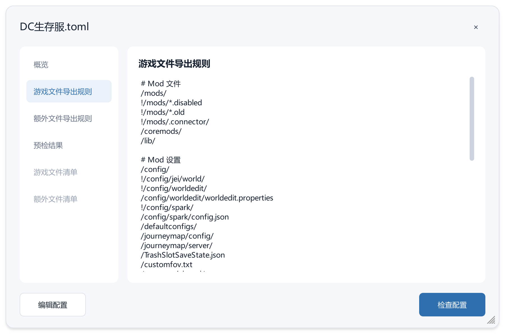
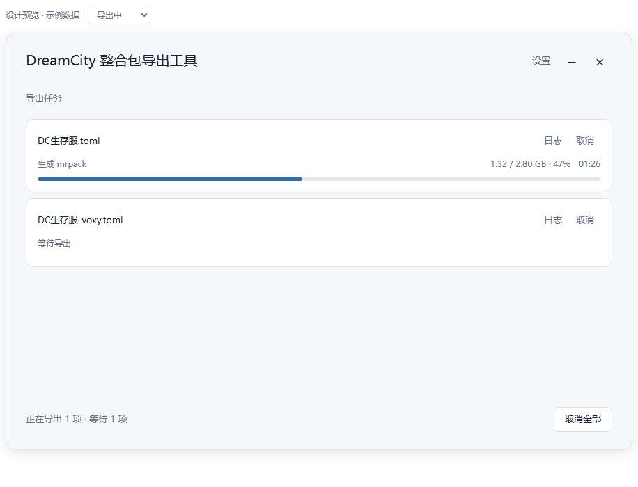
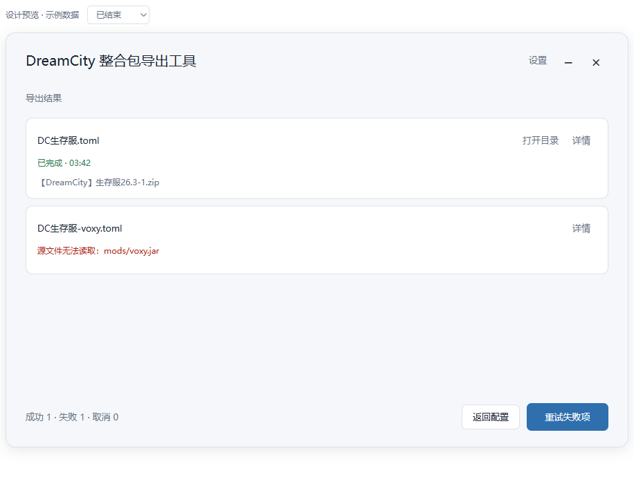

# UI 设计 · 简洁单窗方案

2026-10-24 · 第二版设计及首版 PySide6 实现约定。

以「选择配置 → 开始导出 → 查看结果」为主线，采用 DreamCity 现有工具的浅灰底、白色内容块、蓝色按钮和一体式标题栏。

## 2. 主窗口

建议窗口为 **900 × 600 DIP，固定尺寸**，长列表在内容区内滚动，底部按钮始终可见。Qt 按系统 DPI 缩放。

### 配置列表

- 从工作目录的 `导出/` 第一层读取任务 TOML，按文件名排序，恢复上次勾选
- 每项两行：**配置文件名**；浅灰的「包版本 · 产物类型」
- 仅通过复选框切换勾选；行内名称为普通文字，可选择复制，不响应勾选或显示按钮悬停背景；「详情」单独打开配置详情，不改变勾选。全选支持半选态。
- 解析错误时，第二行改为简短错误，如「配置错误 · 第 12 行」；详情内提供原因与编辑入口
- 启动或刷新成功读取配置目录后，自动删除已不存在配置的勾选记忆并保存；列表只显示当前发现的配置，不显示失效占位项。目录读取失败时保留记忆并提示错误。
- 没有导出配置时，隐藏左上角「选择导出配置：」，右侧文件夹与刷新入口保留原位置；出现配置后恢复标题。

### 底部操作

- 左侧为「全选」复选框，旁边显示「已选择 2 项」或「请选择配置」。全选支持半选态。右侧只有「开始导出」。未选择时禁用。
- 点击开始即按列表顺序读取本批快照并逐项预检，完成整批目标冲突检查。已有目标文件时弹窗标题为「替换已有文件？」，提供「全部替换 / 取消」。所有替换确认后开始工作
- 运行期间锁定本批配置选择；设置和外部文件修改在下一批或重试生效。

## 3. 配置详情

点击「详情」打开默认 **900 × 600 DIP**、最小 **760 × 520 DIP** 的可缩放对话框。顶部为配置文件名和关闭按钮；中间采用**左侧分类 Tab、右侧内容卡片**的布局，底部操作固定。左侧宽约 176 DIP，完整显示分类名称；右侧占据主要空间，随窗口扩展。

左侧分类始终可见，使用水平文字与蓝色选中态，支持鼠标点击及键盘上下键切换。默认选中「概览」，右侧卡片标题与分类名称一致：

| 分类           | 展示                                                         |
| -------------- | ------------------------------------------------------------ |
| 概览             | 整合包、产物、Minecraft 版本、来源和输出路径                  |
| 游戏文件导出规则 | 原始游戏实例规则，保留注释与顺序                               |
| 额外文件导出规则 | 每条外部源路径与包内目标路径；无映射时显示空状态               |
| 预检结果       | 检查状态、输入文件数、估算体积、错误或警告、规则命中统计       |
| 游戏文件清单   | 检查通过后的最终游戏实例文件和大小                             |
| 额外文件清单   | 检查通过后的额外文件、启动器等文件和大小；没有文件时显示空状态 |

右侧为白色圆角卡片，顶部显示当前分类标题，下方内容使用剩余空间；规则、映射、预检及清单均使用可选择复制的只读文本区域。文本区域不固定高度，长行可在区域内横向滚动。仅当前卡片内部滚动，切换分类后保留各自的滚动位置。

概要使用两列布局，左列为浅灰字段名，右列为左对齐的字段值，统一行距，不用空格拼接对齐。长路径自动换行，概要内容超出卡片时在卡片内滚动。展示字段：

| 字段      | 展示                                   |
| --------- | -------------------------------------- |
| 整合包    | 包名与包版本                           |
| 产物      | 完整包 ZIP（含分卷状态）/ mrpack包     |
| Minecraft | 自动识别的游戏与加载器版本             |
| 来源      | 源实例路径，优先显示工作目录相对路径   |
| 输出      | 最终目标路径，优先显示工作目录相对路径 |

「预检结果」默认显示「尚未检查」及检查入口说明。点击「检查配置」后隐藏入口说明，自动切到该分类，耗时扫描使用不定进度；检查期间仍可切换分类查看配置。预检通过后开放两项文件清单 Tab，以独立卡片查看最终清单，与规则命中统计区分；尚未检查、检查失败或结果过期时，两项清单 Tab 置灰。

底部左侧「编辑配置」、右侧蓝色主按钮「检查配置」，两个按钮宽高一致，始终可见。编辑调用文本编辑器，不在 GUI 中维护第二套规则。预检之后配置变化时自动切到「预检结果」，标记「需要重新检查」并清除旧清单；重新检查通过后同步更新概要、规则与映射。正式开始仍以新快照检查。

页面中文本信息均允许选择和复制。

打开详情、设置、日志、目录选择、结果详情及确认/错误等模态子窗口时，主窗口内容表面加一层 `#182230`、约 16% 不透明度的遮罩，覆盖标题栏、内容区和底部操作，保留窗口圆角；子窗口正常显示。遮罩随子窗口关闭而移除；嵌套打开子窗口时保持同一层遮罩，最后一个子窗口关闭后恢复主窗口。

## 4. 导出与结果

开始后，**原列表区域切换为本批任务列表**

任务按配置列表顺序串行执行，同一时刻仅一项正在处理。整批预检时当前项显示「正在预检」，其他待检查项显示「等待预检」；整批预检完成后，通过检查但尚未开始的任务显示「等待导出」。等待项保留「日志」「取消」入口，不显示进度条、百分比或执行耗时。当前任务完成或清理结束后，下一项自动开始；失败项不阻断队列。

每项显示：

1. 配置名，以及「日志」「取消」操作。
2. 当前阶段、真实处理量或阶段百分比、耗时。
3. 一条细进度条；扫描等未知进度使用不定样式。

文件准备阶段显示「准备文件」，随后显示复制和压缩进度；最终压缩进程正常结束即标记成功。阶段结束后清除旧百分比。

底部左侧在预检时显示「正在预检 1 项 · 等待 1 项」，导出时显示「正在导出 1 项 · 等待 1 项」；没有等待项时省略等待数量，全部结束后显示终态数量。运行时右侧按钮为「取消全部」。

取消任一项时显示「取消中」，后台作业停止并清理未完成压缩包和临时目录后再开始下一项。「取消全部」先停止队列推进，再取消每一项。

- **成功**：行内显示「已完成」、耗时及成品名称，提供「打开目录」。原生分卷的精确文件组及「所有分卷放在同一目录，使用第三方解压软件从 `.zip` 打开」的说明放入详情。
- **失败**：行内显示一行具体错误，提供「详情」，展开后查看相关路径和日志；清理失败时列出残留路径。其他任务继续。
- **取消**：显示「已取消」，移除进度条与取消按钮。
- 全部结束后显示「成功 1 · 失败 1 · 取消 0」；底部为「返回配置」及有失败时的「重试失败项」，全成功时为「打开成品目录」。
- 重试重新读取配置和设置，只重建失败任务；重新预检并确认所有需要替换的文件后执行，上批记录保留在详情中。

日志独立对话框默认展示当前任务，支持复制、打开完整日志、自动滚动；完整记录写入文件。

如果程序正在工作中，用户关闭窗口，需要弹窗确认「取消任务并退出 / 返回」。如果程序未工作状态下关闭窗口则直接退出。

## 5. 设置

设置使用同风格的一体式无边框对话框，默认仅显示两项：**压缩等级、完整包分卷**。输出目录由每份导出配置的 `output.directory` 设置。

「高级设置」默认收起，放压缩线程数、临时目录，并显示固定日志目录及「打开日志目录」入口。压缩线程数对应 `execution.compression_threads`，0 自动取逻辑处理器数量，正数指定当前压缩进程的工作线程上限；提示文字为「0 为自动」。自定义分卷选中后才出现数值和单位输入。底部为「取消 / 保存」。

展开或收起高级设置、显示或隐藏自定义分卷输入时，对话框随内容调整高度；反复切换后，收起状态应恢复原有高度和按钮位置，不保留展开时的空白。

## 6. 异常按需出现

| 场景                   | 展示方式                                                                                                                               |
| ---------------------- | -------------------------------------------------------------------------------------------------------------------------------------- |
| 没有配置               | 内容区居中「还没有导出配置」，下一行「将 TOML 放入“导出”文件夹」，提供深色主按钮「打开配置目录」，下方为浅色按钮「生成示例导出配置」 |
| 工具配置损坏           | 底部持续显示「工具设置无法读取」，提供「修复」；开始禁用，保留原文件                                                                   |
| 任务预检失败           | 对应任务行一行原因，详情提供精确路径、行号与修复入口；其他任务继续                                                                     |
| 普通警告               | 行内显示「1 项警告」，详情查看；零匹配不当作失败                                                                                       |
| 目标文件已存在         | 整批执行前统一弹窗列出待替换文件，全部确认后才开始                                                                                     |
| 删除旧文件或清理失败   | 对应项详情提供具体原因及残留路径，日志记录实际处理情况                                                                                 |
| 打开目录、保存设置失败 | 就地保留简短原因与可复制路径，允许重试                                                                                                 |

单实例、源文件只读、目标冲突、覆盖确认、直接输出及失败清理按技术文档执行。内部引擎名、退出码和详细文件处理记录放入日志，日常界面不铺开。

## 7. 视觉与落地

| 项目   | 约定                                                                                                                                                                                                  |
| ------ | ----------------------------------------------------------------------------------------------------------------------------------------------------------------------------------------------------- |
| 窗口   | `#F5F7FA` 浅灰底，14 DIP 圆角，细边框与轻阴影                                                                                                                                                       |
| 内容块 | `#FFFFFF`，无边框，10 DIP 圆角；配置和任务列表不绘制原生条目的焦点、悬停或选中框                                                                                                                    |
| 文字   | 主文字 `#182230`，次级 `#667085`；错误 `#B42318`，成功 `#287A4B`                                                                                                                              |
| 主色   | `#2F6FAD`，沿用美景截图上传工具；只用于主动作、进度与选中控件                                                                                                                                       |
| 字体   | Microsoft YaHei UI / Segoe UI；正文 13 DIP、次级 12 DIP、标题 20 DIP；使用字体像素对齐，文字不参与阴影效果的离屏合成                                                                                  |
| 间距   | 窗口内边距约 28 DIP，列表间距 10 DIP，配置行约 74 DIP                                                                                                                                                 |
| 控件   | 主按钮高 40 DIP，普通输入/按钮高 34～36 DIP；按钮圆角 7 DIP                                                                                                                                           |
| 复选框 | 统一使用自绘 22 × 22 DIP 指示器、5 DIP 圆角；未选中为白底灰边，选中及半选为主蓝色 `#2F6FAD` 配白色勾号或横线；悬停和按下颜色加深，禁用为浅灰底灰色标记；保留原生键盘与无障碍语义，不绘制额外焦点框 |
| 空状态 | 标题与说明间距 8 DIP，说明与按钮间距 20 DIP，两个按钮间距 12 DIP，按钮统一为 180 × 42 DIP                                                                                                            |
| 标题栏 | 一体式可拖动标题区，右侧设置、最小化、关闭；右上角标题栏和工具栏操作文字为 14 DIP、`#344054`；有真实应用版本后再加小徽标                                                                            |
| 动效   | 参考现有项目短暂淡入淡出；进度变化平滑，不添加装饰动效                                                                                                                                                |

PySide6 使用 `QMainWindow`、自绘标题栏、`QStackedWidget` 及列表模型。配置/任务共用固定内容区；设置、配置详情、日志、结果详情、替换/退出确认、错误/启动提示及目录选择统一使用一体式 `QDialog`，共用圆角表面、独立阴影和可拖动标题栏，不叠加系统标题栏或重复标题。弹窗标题区仅提供关闭按钮；可调整大小的弹窗在内部右下角提供缩放手柄。目录选择使用内嵌 Qt 文件选择器
